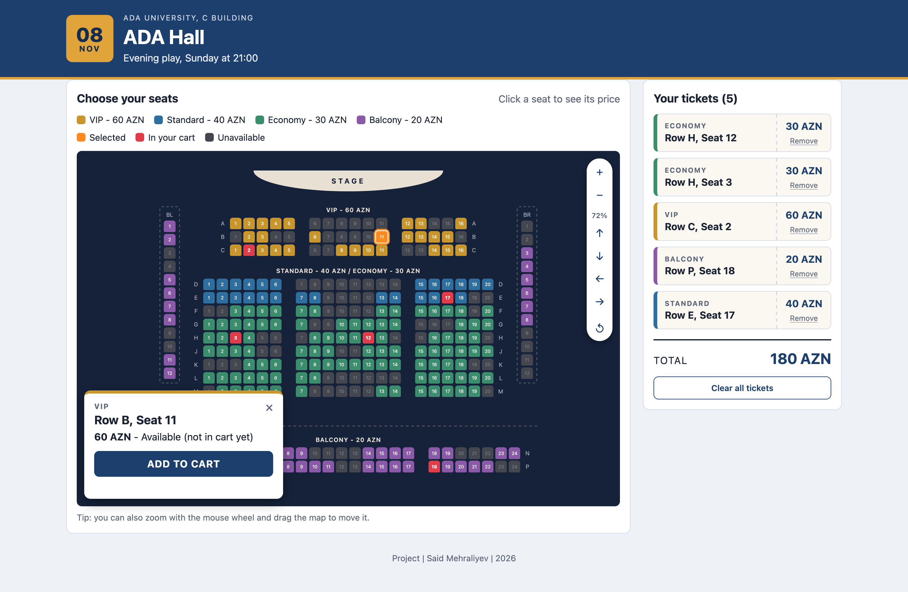

# ADA Hall - Ticketing System

Web and Mobile I project. A page where you can look at a theatre seat map, check a seat and its price, and add tickets to a cart.

Made with plain HTML, CSS and JavaScript.

## Plan

- Venue: the big hall in ADA University's C building (the seat layout and prices are my own, not the real ones)
- Week 1: layout sketch, sections and prices, HTML/CSS structure, venue data in JS
- Week 2: generate the seats from the data, seat states, seat details panel
- Week 3: zoom/move controls, cart, localStorage
- Week 4: responsive layout, testing and fixes, bonus (mouse wheel zoom + drag)

## Venue design

The stage is at the top. The closer to the stage, the more expensive the seat.

| Section     | Rows       | Seats per row | Price  |
|-------------|------------|---------------|--------|
| VIP         | A - C      | 16            | 60 AZN |
| Standard    | D - E      | 20            | 40 AZN |
| Economy     | F - M      | 20            | 30 AZN |
| Balcony     | N, P + side walls BL, BR | 24 (+12 per side) | 20 AZN |

- Like the real hall, every row has two aisles, so the seats are in three blocks: left, middle and right.
- Standard and Economy are one block of rows on the floor (like in my sketch): the first 2 rows are Standard, the rest is cheaper Economy.
- Like the real hall, the balcony goes around the hall in a U shape (about 270°): 2 rows at the back (N, P) and 12 seats along each side wall (BL = balcony left, BR = balcony right).
- Rows I and O are skipped (like in most theatres) so they don't get mixed up with 1 and 0.
- Some seats are already sold / blocked and can't be bought.
- Total: 300 seats.

## Screenshot

## Features

- Seat map with 4 sections and 4 price levels, generated from data in `js/venue-data.js`
- Clicking a seat opens a card over the map with its details and price, only the **Add to cart** button in it adds it
- Seat states: available, selected, in cart, unavailable (each has its own look + legend)
- Zoom in/out, move up/down/left/right and reset view buttons, with limits
- Cart shown as tickets, with remove buttons, clear all, ticket count and total price
- Map and cart stay in sync (removing a ticket frees the seat on the map)
- The same seat cannot be added twice, unavailable seats cannot be added at all
- Max 10 tickets per order
- Cart is saved in localStorage and restored after a refresh (with the seat states)
- Responsive layout for desktop, tablet and phone
- Bonus: mouse wheel zoom (towards the cursor) and click + drag to move the map

## How it works

- `js/venue-data.js` has one `venue` object. Each section has a name, price, colour, list of row letters,
  seats per row and after which seats the two aisles are. Unavailable seats are a list of ids like `"D10"`.
- `js/app.js` loops over the sections and rows and creates a `<button>` for every seat.
  Every seat is also saved in a `seats` object by its id so it can be found quickly.
- The state of a seat is worked out by `getSeatState()` from three things: the unavailable list,
  the cart array and the currently inspected seat. `updateSeat()` then sets the CSS class.
- The cart is an array of seat ids. On every change it is saved to localStorage as JSON, inside an object
  with the seat ids and the time of the change, and it is loaded again when the page opens
  (ids that do not exist, are unavailable or repeated are skipped).
- `js/map-controls.js` moves and zooms the whole map with one CSS `transform`.

## Testing

Tested in Chrome and Safari, and in the Chrome device toolbar (iPhone and iPad sizes).

- clicking a seat shows details, cart does not change until Add to cart
- adding the same seat twice is not possible
- removing a ticket updates the seat on the map
- refresh keeps the cart and the seat states
- unavailable seats cannot be added
- all map buttons + reset view work, zoom stops at the limits
- works at different widths
- broken data in localStorage does not break the page

## How to run

Just open `index.html` in a browser.